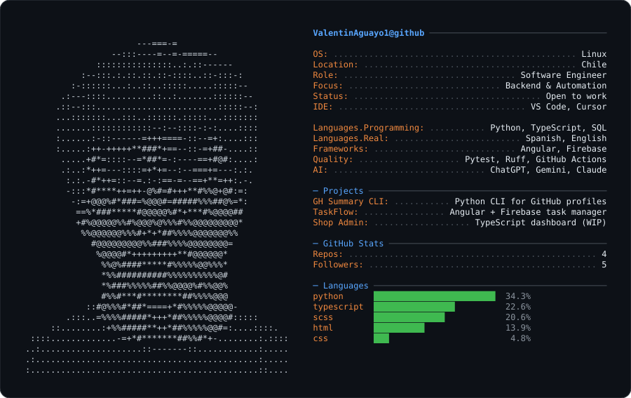

  

## About

Software Engineer based in Chile, focused on **backend services and automation**. I build Python tools and services, and Angular + Firebase applications when a project needs a user interface.

I treat every repository as production code from the first commit: automated tests, linting and CI on every push, small modules with clear responsibilities, and real deployments.

## Featured projects

| Project | Description | Stack |
|---|---|---|
| [**GH Summary CLI**](https://github.com/ValentinAguayo1/gh-summary-cli) | Command-line tool to audit and compare GitHub profiles, with AI-generated summaries. Async HTTP, Markdown/JSON export, tested in CI. | Python, Typer, Rich, httpx, Gemini API |
| [**TaskFlow**](https://github.com/ValentinAguayo1/taskflow) | Task manager with focus mode, drag-and-drop priorities and per-user authentication. Deployed on Firebase Hosting with user-scoped security rules. | Angular, TypeScript, Firebase, Firestore |

## Tech stack

| | |
|---|---|
| **Languages** | Python, TypeScript, SQL |
| **Frameworks & platforms** | Angular, Firebase (Auth, Firestore, Hosting), Typer |
| **Quality & CI** | Pytest, Ruff, GitHub Actions |
| **Tooling** | Git, Linux, LLM APIs (OpenAI, Gemini, Claude) |
| **Also worked with** | JavaScript, Java, C# / .NET, Node.js, React |

## Contact

Open to backend and automation roles.

- Email: [valentin.aguayo@gmail.com](mailto:valentin.aguayo@gmail.com)
- LinkedIn: [linkedin.com/in/valentín-aguayo](https://www.linkedin.com/in/valent%C3%ADn-aguayo)
- Portfolio: [portafolio-valentin-aguayo.netlify.app](https://portafolio-valentin-aguayo.netlify.app/)
